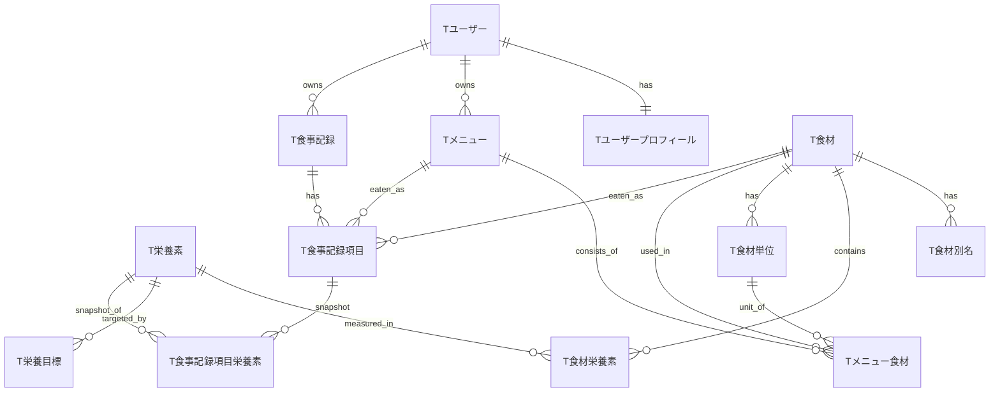

# データモデル

- 状態: ドラフト / 最終更新: 2026-10-17
- DB: MySQL / マイグレーション: EF Core Migrations（[11.技術スタック.md](11.技術スタック.md)）
- 方針・ER 図・栄養素コード一覧の**正本**。テーブルごとの項目・制約・索引・DDL は [05.テーブル定義書.md](05.テーブル定義書.md)。計算式は [03.栄養計算仕様.md](03.栄養計算仕様.md)、マスタ投入は [07.マスタデータ仕様.md](07.マスタデータ仕様.md)。

---

## 1. 方針

| 項目 | 決定 |
|------|------|
| 命名 | テーブルは `T` ＋日本語名、カラムは日本語（主キー `ID`、外部キー `<日本語名>ID`）。区分値・コード値は英語のまま（[ADR-0007](adr/0007-DB物理名を日本語にする.md)） |
| 主キー | `BIGINT AUTO_INCREMENT`（`T栄養素` のみ `SMALLINT`） |
| 監査列 | 全テーブルに `作成日時` / `更新日時` |
| 栄養値 | **縦持ち**（栄養素ごとに 1 行）。理由は [ADR-0003](adr/0003-栄養値の縦持ち.md) |
| 数値 | 栄養値・重量・割合はすべて `DECIMAL`（アプリは `decimal`。NFR-001） |
| 削除 | マスタは `有効フラグ`、メニューは `削除日時`（論理削除）。**食事記録は利用者操作で物理削除**（子はカスケード。暫定） |
| スナップショット | 記録時に栄養値を保存（[ADR-0002](adr/0002-栄養スナップショット.md)） |
| ユーザー | MVP は固定 1 名だが `ユーザーID` を持つ（D-1、[ADR-0005](adr/0005-MVPは固定ユーザー.md)） |

## 2. ER 図

> ER 図はテーブル間の関連のみを示す（Mermaid の ER 図は属性名に日本語を使えないため、列は載せない）。主キー・外部キーを含む全項目は [05.テーブル定義書.md](05.テーブル定義書.md)。

## 3. テーブル一覧

| テーブル | 用途 | マイグレーション |
|----------|------|------------------|
| `T栄養素` | 栄養素マスタ | V1 |
| `T食材` | 食材マスタ | V1 |
| `T食材別名` | 食材の別名（検索用） | V1 |
| `T食材栄養素` | 食材×栄養素の 100g あたり含有量 | V1 |
| `T食材単位` | 食材の換算単位 | V1 |
| `Tユーザー` | 利用者（MVP は 1 名） | V2 |
| `Tユーザープロフィール` | プロフィール | V2 |
| `T栄養目標` | 栄養目標（食事摂取基準） | V2 |
| `Tメニュー` | メニュー（作り置き） | V3 |
| `Tメニュー食材` | メニューの食材 | V3 |
| `T食事記録` | 食事記録（1 食） | V4 |
| `T食事記録項目` | 記録項目（メニューまたは単品食材） | V4 |
| `T食事記録項目栄養素` | 栄養スナップショット | V4 |

各テーブルの項目・制約・索引・DDL は [05.テーブル定義書.md](05.テーブル定義書.md) §3。

## 4. 物理設計の参照先

| 知りたいこと | 参照 |
|--------------|------|
| 列の型・NULL・既定値・キー・C#/API との対応 | [05.テーブル定義書.md §3](05.テーブル定義書.md) |
| DDL（MySQL） | 同 §3 の各テーブル |
| 区分値・コード値の意味 | 同 §4 |
| MySQL 方言の注意点（部分インデックス・CHECK の制約） | 同 §5 |

## 5. 栄養素コード一覧（初期案・暫定）

V1 で `T栄養素` に INSERT する。単位・区分は**取り込み時に成分表の原典と照合する（要確認）**。

| 順 | 栄養素コード | 名称 | 単位 | 区分 | 参考値フラグ | スコアでの使用 |
|----|--------------|------|------|------|--------------|----------------|
| 1 | `ENERGY` | エネルギー | kcal | macro | – | 筋肉（充足）、目標は算出値 |
| 2 | `PROT` | タンパク質 | g | macro | – | 筋肉 |
| 3 | `FAT` | 脂質 | g | macro | – | PFC 比 |
| 4 | `CHO` | 炭水化物 | g | macro | – | PFC 比（炭水化物の定義は原典確認） |
| 5 | `FIBTG` | 食物繊維総量 | g | macro | – | 基礎 |
| 6 | `NACL_EQ` | 食塩相当量 | g | mineral | – | 基礎（減点） |
| 7 | `K` | カリウム | mg | mineral | – | 基礎 |
| 8 | `CA` | カルシウム | mg | mineral | – | 基礎 |
| 9 | `MG` | マグネシウム | mg | mineral | – | 基礎 |
| 10 | `FE` | 鉄 | mg | mineral | – | 基礎 |
| 11 | `ZN` | 亜鉛 | mg | mineral | – | 美肌（重み 0.5） |
| 12 | `VITA_RAE` | ビタミン A（レチノール活性当量） | μg | vitamin | – | 美肌 |
| 13 | `CARTB_EQ` | β-カロテン当量 | μg | vitamin | – | 表示のみ |
| 14 | `VITD` | ビタミン D | μg | vitamin | – | 基礎 |
| 15 | `VITE_ATOC` | ビタミン E（α-トコフェロール） | mg | vitamin | – | 美肌 |
| 16 | `VITK` | ビタミン K | μg | vitamin | – | 表示のみ |
| 17 | `VITB1` | ビタミン B1 | mg | vitamin | – | 基礎 |
| 18 | `VITB2` | ビタミン B2 | mg | vitamin | – | 基礎 |
| 19 | `NIA` | ナイアシン | mg | vitamin | – | 表示のみ |
| 20 | `VITB6` | ビタミン B6 | mg | vitamin | – | 基礎 |
| 21 | `VITB12` | ビタミン B12 | μg | vitamin | – | 基礎 |
| 22 | `FOL` | 葉酸 | μg | vitamin | – | 基礎 |
| 23 | `VITC` | ビタミン C | mg | vitamin | – | 美肌 |
| 24 | `ASTX` | アスタキサンチン | mg（暫定） | antioxidant | **1（参考値）** | スコア外・参考表示のみ（Q-3） |

## 6. マイグレーション分割方針（EF Core Migrations）

論理的に V1〜V4 の 4 グループに分け、それぞれ 1 つ以上の EF Core マイグレーションとして作る（クラス名は `V1_CreateMasterTables` のように接頭辞で順序とグループを示す。クラス名は C# 識別子なので英語）。

| グループ | 内容 |
|----------|------|
| V1 | `T栄養素`, `T食材`, `T食材別名`, `T食材栄養素`, `T食材単位` ＋ `T栄養素` の初期データ（§5） |
| V2 | `Tユーザー`（固定ユーザー 1 行を投入）, `Tユーザープロフィール`, `T栄養目標` |
| V3 | `Tメニュー`, `Tメニュー食材` |
| V4 | `T食事記録`, `T食事記録項目`, `T食事記録項目栄養素` |

- 依存順（V1 → V4）で外部キーが解決する。適用済みのマイグレーションは編集せず、変更は新しいマイグレーションで行う。
- 食材・栄養目標の**データ投入**はマイグレーションに直書きせず、冪等なインポートで行う（[07.マスタデータ仕様.md §5](07.マスタデータ仕様.md)）。
- 日本語名・生成列・CHECK は EF Core の Fluent API で定義し、生成された SQL を [05.テーブル定義書.md](05.テーブル定義書.md) と突き合わせる。
- 開発中のみ、未リリースの間は V1〜V4 を作り直してよい（DB を作り直す）。リリース後は禁止（暫定）。
