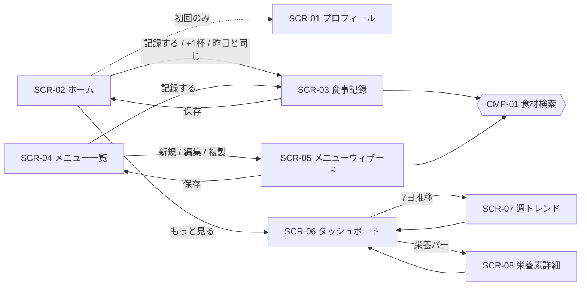

# 画面設計

- 状態: ドラフト / 最終更新: 2026-10-17
- 関連: [01.要件定義.md](01.要件定義.md)（FR）/ [09.API仕様.md](09.API仕様.md)（API）/ [10.受け入れ基準.md](10.受け入れ基準.md)（AC）/ [06.スコアリング仕様.md §7](06.スコアリング仕様.md)（表示規則）
- モバイルファースト（幅 375px で主要操作が完結。NFR-003）。デスクトップは中央カラムで拡大表示するだけで、別レイアウトは作らない（暫定）。

---

## 1. 共通ルール

| 項目 | 規則 |
|------|------|
| ナビゲーション | 画面下部のタブ: ホーム(SCR-02) / 記録(SCR-03) / メニュー(SCR-04) / 分析（=ダッシュボード SCR-06）/ 設定(SCR-01)。タブの表示名は幅 375px に収めるため短くしている |
| 状態の表現 | **色だけで表現しない**（NFR-004）。不足=青系＋「不足」文言＋アイコン、達成=緑系＋「達成」、UL 超過=警告色＋「上限超過」＋アイコン。数値を必ず併記 |
| 文言 | 責めない表現（「足りていません」ではなく「もう少し」「不足気味」）|
| 数値の表示 | 小数 1 桁（kcal は整数）。未測定を含むときは「※」と注記（FR-046） |
| 免責 | ホーム・ダッシュボード・週トレンド・栄養素詳細のフッターに常時表示（FR-047）: 「食事摂取基準に基づく目安であり、医療的助言ではありません」 |
| 調理損失の注記 | メニュー作成・栄養表示に「調理による栄養の変化は考慮していません」 |
| タップ領域 | 44px 以上 |
| 空・エラー状態 | 各画面の「状態」表に定義。API エラーは共通トースト＋再試行 |

## 2. 画面一覧

| ID | 画面 | 主な目的 | 関連 FR |
|----|------|----------|---------|
| SCR-01 | プロフィール設定 | プロフィール入力と目標の確認・上書き | FR-001, FR-002 |
| SCR-02 | ホーム（今日） | 今日の記録一覧・進捗・残量カードからの記録 | FR-027, FR-036, FR-037, FR-040, FR-041, FR-042, FR-046, FR-047 |
| SCR-03 | 食事記録（作成/編集） | メニュー/単品食材の記録 | FR-010, FR-011, FR-030〜FR-036 |
| SCR-04 | メニュー一覧 | メニューの一覧・複製・削除・残量確認 | FR-025, FR-026, FR-027 |
| SCR-05 | メニュー作成/編集ウィザード | メニュー作成（4 ステップ） | FR-010, FR-011, FR-020〜FR-024 |
| SCR-06 | ダッシュボード | スコア・PFC・栄養バー（日/7 日切替） | FR-040〜FR-043, FR-046, FR-047 |
| SCR-07 | 週トレンド | 7 日間の推移 | FR-043, FR-045 |
| SCR-08 | 栄養素詳細 | 栄養素ごとの達成状況と寄与食材 | FR-042, FR-044 |

共通部品: **食材検索ダイアログ（CMP-01）** — SCR-03 と SCR-05 から開く。かな/カナ/漢字/別名で検索（FR-010）し、結果をタップすると食材詳細（FR-011: 栄養素・廃棄率・換算単位・出典/版）を展開表示して選択できる。

## 3. 画面遷移図



- 初回起動でプロフィール未登録の場合は SCR-01 へ誘導する（ホームの栄養表示は目標が必要なため）。

---

## 4. 各画面

### SCR-01 プロフィール設定

**関連**: FR-001, FR-002 / API-04, API-05 / AC-PROF-001〜004

```
┌──────────────────────────┐
│ ← プロフィール            │
├──────────────────────────┤
│ 性別      (●)男性 ( )女性 │
│ 生年月日  [1995-04-01]    │
│ 身長 cm   [170.0]         │
│ 体重 kg   [65.0]          │
│ 活動レベル [2 ▼]          │
│  1:ほぼ座位 2:軽い活動 …   │
│ 目的  (●)美肌 ( )筋肉 ( )両方│
├──────────────────────────┤
│ 自動算出された目標        │
│  エネルギー 2155 kcal     │
│  [ ] 手動で上書き [____]  │
│  タンパク質 65.0 g        │
├──────────────────────────┤
│ [保存]                    │
└──────────────────────────┘
```

| 項目 | 内容 |
|------|------|
| 入力項目 | 性別、生年月日、身長(cm)、体重(kg)、活動レベル(1〜4)、目的(skin/muscle/both)、エネルギー上書き（任意） |
| 操作 | 保存（API-05）。入力変更で目標を即時再表示（算出は [06.スコアリング仕様.md §2](06.スコアリング仕様.md)） |
| バリデーション | 必須: 性別・生年月日・身長・体重・活動レベル・目的。生年月日は過去日。身長 50.0〜250.0、体重 20.0〜300.0（暫定）。体重・身長は小数 1 桁。エネルギー上書きは 500〜10000 の整数（暫定）。上書きチェックを外すと自動算出に戻る |
| 状態 | 初回（未登録）: 空フォームと案内文／保存エラー: 項目別メッセージ／保存成功: トースト |

### SCR-02 ホーム（今日）

**関連**: FR-027, FR-036, FR-037, FR-040〜FR-042, FR-046, FR-047 / API-13, API-14, API-17, API-21 / AC-DASH-001, 002, 007, 009, AC-REC-010, 011, AC-MENU-008

```
┌──────────────────────────┐
│ 今日 10/17(土)  ‹ ›      │
├──────────────────────────┤
│ エネルギー 1,420 / 2,155  │
│ [████████░░░░] 66%        │
│ P 62g  F 40g  C 180g      │
│ PFC比 19% / 27% / 54%     │
├──────────────────────────┤
│ 今日の進捗                │
│ 美肌 81 良好 ✓ 筋肉 75 もう少し│
│ 基礎 62 もう少し  ［詳しく→］│
├──────────────────────────┤
│ 今日の食事                │
│ 朝 トースト… 320kcal  [編集]│
│ 夕 豚汁 1.5杯  …          │
│ [＋記録する] [昨日と同じ]  │
├──────────────────────────┤
│ 作り置き残量              │
│ 豚汁  残 5.5杯 (69%) [＋1杯]│
├──────────────────────────┤
│ ※免責文                  │
└──────────────────────────┘
```

| 項目 | 内容 |
|------|------|
| 表示 | 日付切替（前日/翌日）、kcal 達成バー、PFC(g)・PFC 比、「今日の進捗」3 スコア（ミニ表示）、食事ごとの記録リスト、残量カード、免責 |
| 操作 | 記録する（→SCR-03）、記録の編集/削除（FR-033）、昨日と同じ（FR-036: コピー確認ダイアログ→API-21）、残量カードの「+1 杯」（FR-037: SERVING 1 で API-14）、「詳しく」（→SCR-06） |
| バリデーション | 昨日と同じ: 前日に記録が無い場合は押せない／今日に記録がある場合は「追加しますか」と確認（409 対応） |
| 状態 | 記録なし: 「まだ記録がありません。最初の 1 食を記録しましょう」＋記録ボタン／メニューなし: 残量カード非表示／欠測あり: 該当値に「※」／取得エラー: 再試行ボタン／プロフィール未登録: SCR-01 へ誘導 |

### SCR-03 食事記録（作成/編集）

**関連**: FR-010, FR-011, FR-030〜FR-036 / API-01, API-02, API-08, API-13〜API-16, API-20 / AC-REC-001〜011, AC-FOOD-001〜005

```
┌──────────────────────────┐
│ ← 食事を記録              │
│ 日付 [2026-10-17] 区分 [夕▼]│
├──────────────────────────┤
│ ［最近使った］            │
│ (豚汁)(ご飯 150g)(卵)…    │
├──────────────────────────┤
│ 追加: [メニューから][食材から]│
│ ┌ 豚汁（残 5.5杯）        │
│ │ クイック:               │
│ │ (1杯)(1.5杯)(1/2杯)(g入力)│
│ │ 入力: [1.5] 杯 → 450g   │
│ │ 約 357 kcal  [削除]     │
│ └                         │
│ ┌ ご飯 [150] g [削除]     │
├──────────────────────────┤
│ ⚠ 豚汁の記録が合計100%を超えます │
│ 合計 約 620 kcal          │
│ [保存]                    │
└──────────────────────────┘
```

| 項目 | 内容 |
|------|------|
| 入力項目 | 日付、食事区分(朝/昼/夕/間食)、メモ、記録項目（複数可: FR-032）。メニュー項目は入力方式（クイックチップ「1 杯/1.5 杯/1/2 杯」=SERVING・RATIO、「g 入力」=GRAM）と値。単品食材は g または単位＋数量 |
| 操作 | メニュー選択（メニュー一覧から）、食材検索（CMP-01）、最近使った（FR-035）から追加、項目削除、保存（API-14 / 編集時 API-15）、記録削除（API-16） |
| バリデーション | 日付必須（未来日は警告のみ・暫定）。項目 1 件以上。値は 0 より大きい。GRAM はメニューの完成後重量以内を推奨（超えれば 100% 超過警告）。メニューの合計記録が 100% 超 → 警告（FR-034、**保存は可能**）。論理削除済みメニューは選択不可 |
| 状態 | メニュー無し: 「メニューがありません」＋メニュー作成導線／最近使った無し: 非表示／編集時: 既存値を表示／保存エラー: 項目別メッセージ（details） |
| プレビュー | 入力に応じて概算 kcal を表示（クライアントでメニュー合計×割合。確定値はサーバー計算、[03.栄養計算仕様.md](03.栄養計算仕様.md)） |

### SCR-04 メニュー一覧

**関連**: FR-025, FR-026, FR-027 / API-06, API-10, API-11 / AC-MENU-006〜008

```
┌──────────────────────────┐
│ メニュー          [＋新規] │
├──────────────────────────┤
│ 豚汁   10/14作成          │
│ 8杯分(お椀)  残 5.5杯 69% │
│ [記録する][複製][編集][削除]│
├──────────────────────────┤
│ 鶏むねの蒸し鶏  …         │
└──────────────────────────┘
```

| 項目 | 内容 |
|------|------|
| 表示 | 名前、作成日、杯数とラベル、残量（杯・%）、メモ |
| 操作 | 新規（→SCR-05）、編集（→SCR-05）、複製（API-11 → SCR-05 で名前を確認・編集）、論理削除（確認ダイアログ「過去の記録は残ります」）、記録する（→SCR-03） |
| バリデーション | 削除は確認必須。残量がマイナス（記録超過）の場合は赤系ではなく注意アイコン＋文言「記録が 100% を超えています」 |
| 状態 | メニュー無し: 「最初のメニューを作りましょう」＋新規／取得エラー: 再試行 |

### SCR-05 メニュー作成/編集ウィザード

**関連**: FR-010, FR-011, FR-020〜FR-024, FR-025 / API-01, API-02, API-07〜API-09, API-12 / AC-MENU-001〜005, 009, AC-CALC-001〜008

4 ステップ。ステップ間の移動は戻る/次へ。常に上部に「現在の栄養合計（プレビュー）」を表示。

```
① 名前            ② 食材追加 + リアルタイム栄養
┌────────────────┐ ┌──────────────────────────┐
│ ① ②  ③  ④       │ │ ① [②] ③ ④               │
│ メニュー名       │ │ [＋食材を追加(検索)]     │
│ [豚汁_________]  │ │ にんじん [2] [本▼] =300g │
│ 作った日 [10/14] │ │ 豚こま肉 [400] [g▼]      │
│ メモ            │ │ みそ [4] [大さじ▼] =72g  │
│ [次へ]           │ │ ─ 栄養プレビュー(合計)  ─ │
└────────────────┘ │ P 91.3g VITC 31mg ※     │
                   │ [戻る][次へ]              │
③ 完成重量          └──────────────────────────┘
┌──────────────────┐ ④ 1食分定義と確認
│ 鍋ごとの重さ [3000]g│ ┌──────────────────────────┐
│ 空鍋の重さ  [600] g│ │ 杯数 [8] ラベル [お椀 ▼] │
│ → 完成後重量 2400g │ │ 1杯 = 300g               │
│ （直接入力も可）   │ │ 1杯あたり: 456kcal P11.4g…│
│ [戻る][次へ]       │ │ ※調理損失は考慮しません   │
└──────────────────┘ │ [戻る][保存]              │
                     └──────────────────────────┘
```

| ステップ | 項目 | 操作 | バリデーション |
|----------|------|------|----------------|
| ① 名前 | メニュー名、作った日、メモ | 次へ | 名前必須・100 文字以内、メモ 500 文字以内 |
| ② 食材 | 食材行（食材、数量、単位 or g）、並べ替え、削除 | 食材検索（CMP-01）、数量変更で**リアルタイム栄養プレビュー**（API-12、デバウンス 300ms）。換算後 g を併記（FR-020, FR-021） | 1 件以上。数量 > 0（小数 2 桁）。無効化された食材は選べない。単位が無い食材は g のみ |
| ③ 完成重量 | 鍋ごとの重さ、空鍋の重さ、（直接入力） | 差し引きで完成後重量を自動算出（FR-022）。直接入力に切替可 | 完成後重量 > 0（小数 1 桁）。鍋重量 > 空鍋重量。食材合計（廃棄前）より大幅に小さい/大きい場合は注意表示（暫定） |
| ④ 1 食分 | 杯数、杯ラベル | 1 杯の重さ（= 完成後重量 ÷ 杯数）と 1 杯あたり栄養を表示（FR-023）、保存（API-07 / 編集時 API-09） | 杯数 > 0（小数 1 桁）、ラベル 20 文字以内 |

| 状態 | 内容 |
|------|------|
| 編集（FR-024） | 既存値を読み込んで同じウィザードを開く。保存時に「過去の記録は変わりません」と表示 |
| 複製（FR-025） | 元メニューの内容を複製して ①から開始（名前に「のコピー」を付与） |
| プレビュー中 | 計算中スピナー。エラー時は直近の成功値を薄く残し、再試行 |
| 欠測 | 未測定の食材を含む栄養素に「※」。行ごとに該当食材名を表示 |
| 離脱 | 未保存のまま離脱するときは確認ダイアログ |

### SCR-06 ダッシュボード

**関連**: FR-040〜FR-043, FR-046, FR-047 / API-17, API-18, API-03 / AC-DASH-001〜004, 007〜009, AC-SCORE-001〜011

```
┌──────────────────────────┐
│ ダッシュボード            │
│ [今日 | 7日平均]  10/17   │
├──────────────────────────┤
│  ◯美肌81   ◯筋肉75  ◯基礎62│
│  良好✓    もう少し△  もう少し△│
│  （リング。中央に数値、下に文言）│
├──────────────────────────┤
│ kcal 1,420 / 2,155        │
│ PFC [P19%|F27%|C54%] 帯  │
├──────────────────────────┤
│ 栄養バー                  │
│ ビタミンC ■■■■■□ 78/100mg  不足(青) │
│ 鉄       ■■■■■■ 達成 緑  │
│ 食塩相当 ⚠ 上限超過       │
│ （タップで SCR-08）       │
├──────────────────────────┤
│ 7日推移 ▁▃▅▇▅▃▆ [→SCR-07]│
│ 作り置き残量 豚汁 5.5杯   │
├──────────────────────────┤
│ ※データ不足/未測定の注記  │
│ ※免責文                  │
└──────────────────────────┘
```

| 項目 | 内容 |
|------|------|
| 表示 | 日/7 日平均切替（FR-043）、3 スコアのリング（整数＋帯の文言＋アイコン）、kcal 達成、PFC(g)と PFC 比、栄養バー（不足=青系・達成=緑系・UL 超過=警告、数値併記）、7 日推移への導線、残量、注記、免責 |
| 操作 | 切替、日付/期間終了日の移動、栄養バーのタップ（→SCR-08）、7 日推移（→SCR-07） |
| バリデーション | 日付は未来日不可。7 日平均で記録日 < 3 日: スコア非表示＋「データ不足（記録 n 日）」（FR-046） |
| 状態 | 記録なし: 「記録するとここに表示されます」／欠測あり: 「※未測定の食材を含むため低めの可能性」／ASTX: 参考値として別枠表示（スコア外） |

### SCR-07 週トレンド

**関連**: FR-043, FR-045 / API-18 / AC-DASH-006

| 項目 | 内容 |
|------|------|
| 表示 | 直近 7 日の kcal（棒）とスコア（3 本の折れ線）。日ごとの記録有無。期間内の UL 超過日数 |
| 操作 | 期間終了日の移動、日をタップで SCR-06（その日）へ、系列の表示切替 |
| バリデーション | 終了日は未来日不可 |
| 状態 | 記録のない日: 欠けた点として表示（0 にしない）／全日記録なし: 空状態／線の区別は色だけでなく線種・マーカーも使う（NFR-004） |

### SCR-08 栄養素詳細

**関連**: FR-042, FR-044 / API-03, API-19 / AC-DASH-005

| 項目 | 内容 |
|------|------|
| 表示 | 栄養素名、期間（日/7 日）、摂取量/目標、達成率、UL との比較、寄与食材ランキング（記録項目単位の寄与量・割合。メニューは構成食材へ展開: 暫定、[03.栄養計算仕様.md §8](03.栄養計算仕様.md)）、欠測の注記 |
| 操作 | 期間切替、寄与項目の展開（メニュー→食材） |
| バリデーション | 栄養素コードが存在すること。期間の開始 ≤ 終了 |
| 状態 | 記録なし: 空状態／ASTX 等の参考値: 「参考値（スコア外）」を明記／取得エラー: 再試行 |

---

## 5. URL（ルーティング）

| 画面 | URL | 備考 |
|------|-----|------|
| SCR-02 ホーム | `/` | プロフィール未登録なら `/profile?first=1` へ |
| SCR-01 プロフィール | `/profile` | `?first=1` で初回の案内を表示 |
| SCR-03 食事記録（作成） | `/record` | `?date=yyyy-MM-dd`（記録する日）、`?menuId=`（メニューを最初から追加） |
| SCR-03 食事記録（編集） | `/record/:id?date=yyyy-MM-dd` | 記録の日付が必要（API-13 が日付で取得するため） |
| SCR-04 メニュー一覧 | `/menus` | – |
| SCR-05 メニュー作成 | `/menus/new` | 複製は API-11 のあと `/menus/:id/edit` へ |
| SCR-05 メニュー編集 | `/menus/:id/edit` | – |
| SCR-06 ダッシュボード | `/dashboard` | 今日／7 日平均はページ内で切替 |
| SCR-07 週トレンド | `/trend` | – |
| SCR-08 栄養素詳細 | `/nutrients/:code` | 例: `/nutrients/VITC` |
