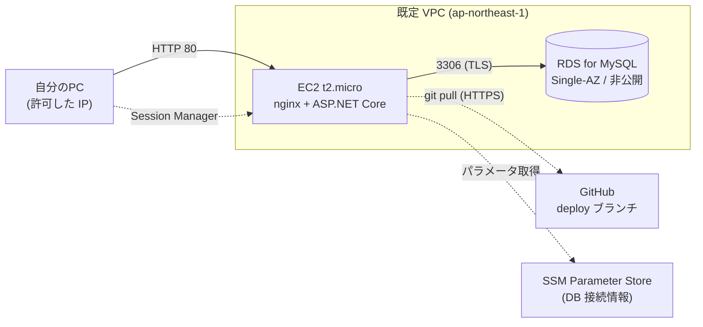

# デプロイ設計

- 状態: ドラフト / 最終更新: 2026-10-17
- AWS へのデプロイ構成・手順・費用管理の正本。開発の段階は [13.開発手順.md](13.開発手順.md)（本書の実施は**フェーズ 4**）、技術は [11.技術スタック.md](11.技術スタック.md)。
- 目的は**動作確認**。確認が済んだらすぐに環境を破棄する前提で、固定費の高い構成を避ける（NFR-006）。
- **本書の金額・仕様のうち確証のないものは「要確認」**。AWS のリソースを作る前に、請求画面と公式の料金ページで確認する。

---

## 1. 決定事項

| # | 決定 | 備考 |
|---|------|------|
| DP-1 | リージョンは**東京**（`ap-northeast-1`） | – |
| DP-2 | AWS の操作は**すべて Terraform**で行う（手作業のコンソール操作でリソースを作らない） | §4。適用（`terraform apply`）は利用者が行い、事前に私が `plan` を提示する |
| DP-3 | アプリの実行環境は **EC2 の t2.micro** 1 台 | メモリ 1GB のため、ビルドは EC2 上で行わない（§5） |
| DP-4 | データベースは **RDS for MySQL**（EC2 上の Docker ではない） | §3.3 |
| DP-5 | 公開範囲は**自分の IP のみ許可**（セキュリティグループ）。認証は導入しない（ADR-0005、Q-6） | HTTP のみ（独自ドメイン・証明書なし） |
| DP-6 | デプロイは**デプロイ用ブランチ（`deploy`）を EC2 で pull**して行う（ファイル転送ではない） | §5 |
| DP-7 | **動作確認後すぐに破棄**する（`terraform destroy`） | §8 |
| DP-8 | 順序は **EC2 を作って疎通確認 → RDS を作成 → デプロイ** | §6 |

## 2. 構成



| 要素 | 内容 |
|------|------|
| ネットワーク | **既定 VPC** を使う。VPC・NAT ゲートウェイ・ロードバランサは作らない（固定費を避ける） |
| EC2 | Amazon Linux 2023（x86_64。t2 は x86 のみ）。EBS は最小の汎用 SSD。パブリック IPv4 を自動付与（Elastic IP は使わない） |
| nginx | フロントの静的ファイルを配信し、`/api` と `/health` を `127.0.0.1:8080`（ASP.NET Core）へ転送する。同一オリジンなので CORS は不要 |
| ASP.NET Core | `systemd` サービスとして `127.0.0.1:8080` で待ち受ける |
| RDS | MySQL（Single-AZ、パブリックアクセス無効）。EC2 のセキュリティグループからの 3306 のみ許可 |
| 接続 | シェルは **Session Manager**（SSH 用のポートとキーペアを持たない） |

## 3. 費用管理（最重要）

### 3.1 作成前の確認（フェーズ 4 の開始条件）

| # | 確認 | 方法 |
|---|------|------|
| 1 | 無料枠の対象か（アカウントの作成時期により「12 か月の無料枠」か「クレジット制」かが異なる） | AWS の請求画面（Billing and Cost Management）の Free Tier ページ。**要確認** |
| 2 | t2.micro と、使う RDS インスタンスクラスが無料枠の対象か（リージョンでも異なる） | 同上と公式の料金ページ。**要確認** |
| 3 | 予算アラートが有効か | Terraform の `aws_budgets_budget`（§4）。少額の上限を設定 |
| 4 | 認証情報が有効か | `aws sts get-caller-identity` |

### 3.2 課金されうる項目

| 項目 | 方針 |
|------|------|
| EC2（t2.micro） | 動かした時間に課金。無料枠の対象外なら時間課金 |
| EBS | 最小サイズ。破棄時に一緒に削除（`delete_on_termination`） |
| パブリック IPv4 | **課金対象と認識している（要確認）**。無料枠でも対象外になりうる |
| RDS（インスタンス） | 動かしている間ずっと課金。停止しても最大 7 日で自動再開する。**短期間で破棄**する |
| RDS（ストレージ・バックアップ） | ストレージは最小。自動バックアップは 0 日、最終スナップショットは取らない（スナップショットのストレージが残るため） |
| データ転送 | 自分の PC との通信のみで小さい見込み |
| 作らないもの | NAT ゲートウェイ、ロードバランサ、Elastic IP、Multi-AZ、CloudWatch の詳細監視、Performance Insights |

- 具体的な単価はここに書かない（変動するため）。作成直前に、AWS の公式料金ページと Pricing Calculator で見積もり、**見積もりをこの表の下に追記してから**作成する。
- 稼働時間の想定: フェーズ 4 全体を**同日中**に終え、同日中に破棄する。

### 3.3 RDS の設定

| 項目 | 設定 |
|------|------|
| エンジン | MySQL 8.4 系を想定（**RDS で選べるか要確認**）。ローカルの Docker MySQL も同じ系統にそろえる |
| インスタンスクラス | 無料枠の対象で、選んだエンジンバージョンが対応するもの（`db.t3.micro` または `db.t4g.micro` を想定。**要確認**） |
| 配置 | Single-AZ、既定 VPC のサブネット。**パブリックアクセス無効** |
| ストレージ | 最小サイズ。暗号化は有効 |
| バックアップ | 自動バックアップ保持 0 日、最終スナップショットなし（学習用・短命のため） |
| 削除保護 | 無効（`terraform destroy` で消せること） |
| 文字コード | `utf8mb4`（[05.テーブル定義書.md §1.2](05.テーブル定義書.md)） |
| 接続 | TLS を必須にする（パラメータグループ。**パラメータ名と動作は要確認**） |
| セキュリティグループ | 3306 を EC2 のセキュリティグループからのみ許可 |

## 4. Terraform

### 4.1 配置と方針

```
infra/terraform/
├── versions.tf          # Terraform と AWS プロバイダのバージョンを固定
├── variables.tf         # my_ip_cidr, enable_rds, budget_limit_usd, budget_email …
├── network.tf           # 既定 VPC・サブネットの参照、セキュリティグループ
├── ec2.tf               # EC2、user_data（初期設定）
├── iam.tf               # EC2 用ロール（Session Manager、SSM パラメータ読取）
├── rds.tf               # RDS（enable_rds が true のときだけ作成）
├── ssm.tf               # DB パスワード等を SSM Parameter Store（SecureString）に保存
├── budget.tf            # AWS Budgets（予算アラート）
├── outputs.tf           # EC2 のパブリック IP、RDS エンドポイント
├── user_data.sh.tftpl   # nginx・ランタイム導入、スワップ、deploy ブランチの clone
└── terraform.tfvars.example   # 変数の例（実値は terraform.tfvars に書き、コミットしない）
```

| 項目 | 方針 |
|------|------|
| 状態ファイル | **ローカル**（`terraform.tfstate`）。コミットしない。DB パスワードが含まれるため扱いに注意 |
| `.gitignore` | `*.tfstate*`、`.terraform/`、`terraform.tfvars` を除外。`.terraform.lock.hcl` はコミットする |
| 変数 | 自分の IP（`my_ip_cidr`、`/32`）、予算額、通知先メールは `terraform.tfvars` に置く（公開リポジトリに載せない） |
| 段階的な作成 | `enable_rds`（既定 `false`）。フェーズ 4-1 は EC2 のみ、4-2 で `true` にして RDS を追加する |
| 適用の手順 | 私が `terraform plan` を実行して差分を示し、**利用者が内容を確認して `terraform apply`** を実行する。破棄も同様 |
| 実装時期 | `.tf` ファイルはフェーズ 4 の開始時に作成する（現時点では未作成） |
| バージョン | Terraform は 1.11 系（手元の環境）。AWS プロバイダは作成時に確認して固定する |

### 4.2 シークレット

| 項目 | 方針 |
|------|------|
| DB パスワード | Terraform の `random_password` で生成し、SSM Parameter Store の SecureString に保存する。リポジトリに書かない |
| EC2 の取得 | EC2 のロールに該当パラメータの読取のみ許可。デプロイ時に取得して環境ファイル（`/etc/nutrition-tracker.env`、root のみ読取）に書く |
| 接続文字列 | `appsettings.json` には書かず、環境変数（`ConnectionStrings__Default`）で渡す |

### 4.3 アクセス制御

| 項目 | 設定 |
|------|------|
| EC2 の受信 | **TCP 80 を `my_ip_cidr` からのみ**許可。22 は開けない |
| シェル | Session Manager（EC2 に `AmazonSSMManagedInstanceCore` 相当のロールを付与） |
| IP が変わったとき | `terraform.tfvars` の `my_ip_cidr` を更新して `terraform apply`（セキュリティグループのみ変更） |
| 通信 | HTTP（TLS なし）。自分の IP のみに絞ることで許容する。扱うデータは学習用の食事記録のみ |

## 5. デプロイ方式（`deploy` ブランチを EC2 で pull）

### 5.1 考え方

- t2.micro はメモリ 1GB のため、**Angular と .NET のビルドは EC2 上で行わない**。手元でビルドし、**成果物を `deploy` ブランチにコミット**する。EC2 はそのブランチを `git pull` して反映する。
- リポジトリは公開なので、EC2 から認証なしで取得できる（HTTPS）。
- `deploy` ブランチは**ソースを含まない**成果物専用ブランチ（`dev`/`main` とは履歴が独立）。`dev`/`main` への直接コミット禁止のルールとは別枠で、**成果物の更新はビルド用スクリプト経由のみ、かつ利用者の指示があったときだけ**行う。

### 5.2 `deploy` ブランチの内容

```
(deploy ブランチ)
├── frontend/          # ng build の出力（静的ファイル）
├── backend/           # dotnet publish の出力（linux-x64、ランタイム非同梱）
├── migrate/           # EF Core マイグレーションの bundle（linux-x64）
├── nginx/nutrition-tracker.conf
├── systemd/nutrition-tracker.service
├── scripts/deploy.sh  # EC2 上で実行する反映スクリプト
└── VERSION            # 元になったコミットの SHA とビルド日時
```

| 項目 | 内容 |
|------|------|
| 作り方 | リポジトリ内のスクリプト（例: `scripts/build-deploy.sh`）が、`main`（または指定コミット）をビルドして `deploy` ブランチ用の作業ツリーに出力する。**シークレットは含めない** |
| ビルド環境 | 手元の Mac（arm64）。.NET は `-r linux-x64` で EC2 向けに出力（クロスビルド。bundle も同様に動くか**要確認**） |
| ランタイム | EC2 に ASP.NET Core ランタイムを導入する（`user_data`。導入方法は**要確認**: 公式インストールスクリプトまたは OS のパッケージ） |
| 容量 | 成果物が履歴に残るため肥大する。EC2 では `--depth 1` で取得。環境を破棄したら `deploy` ブランチも削除してよい |

### 5.3 EC2 側の反映（`scripts/deploy.sh`）

1. `git fetch --depth 1 origin deploy` → `git reset --hard FETCH_HEAD`
2. SSM から DB 接続情報を取得し、環境ファイルを更新
3. `migrate/` のバンドルを実行して DB を最新にする（**アプリ起動時の自動マイグレーションはしない**）
4. `systemctl restart nutrition-tracker` と `nginx -s reload`
5. `curl http://127.0.0.1:8080/health` で `{"status":"ok"}` を確認。失敗したら中断して報告

- **ロールバック**: 直前の SHA に `git reset --hard` して手順 4〜5 を行う。マイグレーションは前進のみで、戻す場合は別途対応が必要（学習用のため DB を作り直す選択もできる）。

## 6. 手順

### 4-0 事前確認

1. §3.1 の確認（無料枠・予算・認証）
2. `infra/terraform/` を作成し、`terraform.tfvars` を用意（自分の IP は手元で確認）
3. `terraform init` → `terraform plan`（EC2 のみ、`enable_rds=false`）。**差分を確認してから**次へ

### 4-1 EC2 のみ作成と疎通確認

| 確認項目 | 期待 |
|----------|------|
| `terraform apply` が成功し、パブリック IP が出力される | – |
| Session Manager でログインできる | ○ |
| 自分の IP から `http://<IP>/` が応答する（nginx の既定ページ） | ○ |
| **別回線（スマートフォンのモバイル回線など）**から同じ URL にアクセスできない | ○（IP 制限が効いている） |
| ランタイム・nginx・git が導入済み、`deploy` ブランチの clone ができる | ○ |

### 4-2 RDS を作成して EC2 から接続確認

1. `enable_rds=true` にして `terraform plan` → 確認 → `apply`
2. EC2 から RDS のエンドポイントへ 3306 で接続し、TLS で認証できることを確認（クライアントの導入方法は**要確認**）
3. パブリックからは接続できないことを確認（RDS にパブリック IP がない）

### 4-3 デプロイと動作確認

1. 手元でビルドして `deploy` ブランチを更新（指示があったときのみコミット・プッシュ）
2. EC2 で `scripts/deploy.sh` を実行
3. §7 のスモークテスト

### 4-4 破棄

§8 に従う。

## 7. スモークテスト

| # | 確認 | 期待 |
|---|------|------|
| 1 | `GET /health` | `{"status":"ok"}` |
| 2 | `GET /api/nutrients` | 24 件（[04.データモデル.md §5](04.データモデル.md)） |
| 3 | 画面の表示（`http://<IP>/`） | プロフィール未登録なら SCR-01 へ誘導される |
| 4 | プロフィール登録 → 目標が表示 | [10.受け入れ基準.md](10.受け入れ基準.md) AC-PROF-001 |
| 5 | テスト用メニューの作成 → 記録 → ホームに反映 | AC-MENU-001, AC-REC-002 |
| 6 | 再デプロイ（`deploy.sh`）後もデータが残る | RDS にデータが保持される |
| 7 | 別回線からのアクセスが拒否される | IP 制限 |

## 8. 破棄（確認後すぐに実施）

1. `terraform destroy`（RDS は最終スナップショットなし、EBS は一緒に削除）
2. **残存確認**（コンソールまたは CLI。東京リージョン）: EC2 インスタンス、EBS ボリューム、RDS インスタンスと**スナップショット**、Elastic IP、SSM パラメータ、CloudWatch のロググループ
3. 翌日、請求画面（Cost Explorer）で課金が発生していないことを確認
4. ローカルの `terraform.tfstate` を削除（シークレットを含むため）
5. `deploy` ブランチ（リモート）が不要なら削除する（利用者の指示があったときに）
6. 予算アラートは `terraform destroy` に含まれる。残す場合は別管理にする

## 9. リスク

| リスク | 対策 |
|--------|------|
| 無料枠の対象外で想定外の課金 | §3.1 で事前確認。予算アラート。同日中に破棄 |
| 自宅 IP の変更で自分も接続できなくなる | `my_ip_cidr` を更新して `apply`。Session Manager は IP に依存しない |
| 破棄忘れ | §8 のチェックリスト。破棄後の翌日の請求確認 |
| t2.micro のメモリ不足 | ビルドを EC2 でしない。スワップを追加。nginx + ASP.NET Core のみ載せる |
| Mac（arm64）から EC2（x86_64）向けのビルド | `-r linux-x64` で出力。bundle の動作は要確認 |
| 状態ファイル・環境ファイルのシークレット流出 | コミット禁止（`.gitignore`）。破棄後に削除 |
| HTTP のため通信が平文 | 自分の IP のみに限定。学習用データのみ |

## 10. 未確認事項（作成前に解消する）

| # | 内容 |
|---|------|
| 1 | 無料枠の対象か（アカウント作成時期）。t2.micro と RDS のインスタンスクラス、パブリック IPv4 の課金 |
| 2 | RDS で MySQL 8.4 系とインスタンスクラスが選べるか。TLS 必須のパラメータ名 |
| 3 | EC2（Amazon Linux 2023）への ASP.NET Core ランタイムの導入方法。MySQL クライアントの導入方法 |
| 4 | クロスビルド（arm64 → linux-x64）で EF Core の bundle が動作するか |
| 5 | AWS Budgets の無料範囲 |
